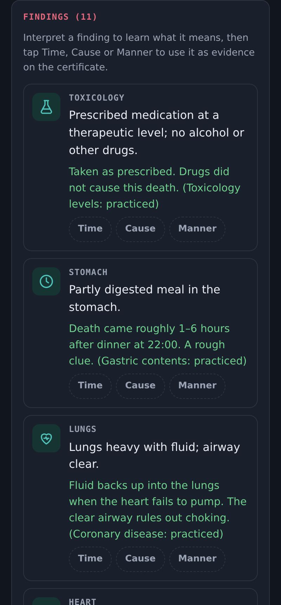
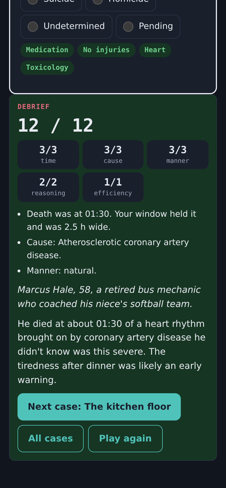
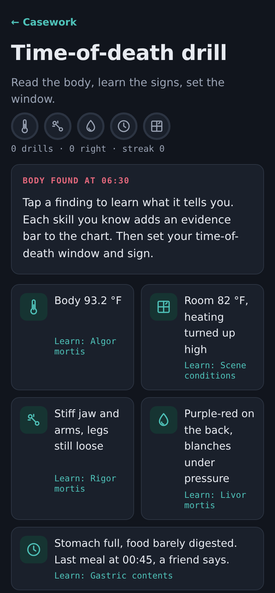

# Casework

A medical examiner game where the forensic science is real. Examine a body, learn what each finding
means at the moment you need it, and sign the death certificate: cause, manner, and a time-of-death
window that scores best when it is both right and tight.

> **Status:** early development, playable. **Three cases** (a natural death, an accident and a
> homicide whose timeline doesn't match the story), each with a 3D exam room, plus an endless
> **time-of-death drill**.

## How a case plays

<table>
  <tr>
    <td></td>
    <td></td>
    <td></td>
    <td></td>
  </tr>
  <tr>
    <td>Examine the body in 3D</td>
    <td>Interpret and link findings</td>
    <td>Fill in the certificate</td>
    <td>Sign and see the truth</td>
  </tr>
</table>

- **Procedures:** spend shift hours and lab budget on the scene investigation, external exam,
  autopsy and toxicology. Some need others first, and some cases have tests you don't need.
- **Examine:** the external exam opens a 3D exam room (Strata, in the browser). Tap a region of the
  body to examine it, and turn the body over to check the back. Where 3D can't run, the same regions
  are buttons.
- **Interpret:** turning a finding into evidence needs a skill. If you don't have it yet, a
  one-question lesson opens right there. Your skill level sets how precise timing evidence is.
- **Link:** tap Time, Cause or Manner on an interpreted finding to use it as evidence on the
  certificate. Every line needs support before you can sign.
- **Sign and debrief:** set the time-of-death window, choose cause and manner, sign. The debrief
  scores time (right and tight), cause, manner, reasoning (did your links hold?) and efficiency,
  shows who the person was and what happened, and turns mistakes into review cards.

The tone is clinical and non-graphic: a stylized, faceless mannequin, injuries described in words,
and a respectful line about each person.

### The time-of-death drill

An endless practice mode: a generated body, the early signs of death, and a window to set.

<table>
  <tr>
    <td></td>
    <td></td>
    <td></td>
    <td></td>
  </tr>
  <tr>
    <td>1. Read the body</td>
    <td>2. Learn what a finding means</td>
    <td>3. Weigh the evidence</td>
    <td>4. Sign and see the truth</td>
  </tr>
</table>

Each skill's colour shows how well you know it: amber for novice (a wider bar), teal for practiced, green for mastered.

### In a terminal

Every case can also be played as text, for people, AI playtesters and scripted checks:

```sh
npm run play -- night-shift          # type "help" for commands
npm run play -- night-shift < moves.txt
```

## Design

- [docs/design.md](docs/design.md): core loop, decisions and milestones.
- Case data format, scoring and milestones: [docs/design.md](docs/design.md). Cases are JSON in
  `packs/forensics-core/cases/`; `tests/cases.test.ts` checks each one is valid and that an expert
  can score 12/12 using only what the case shows.
- Screenshots are made by `npm run shots` (see `tools/shots.cjs`), which plays one drill with a
  fixed seed (`?seed=99`) at phone and desktop sizes and fails on console errors or overflow.
- Architecture: ports and adapters. `src/kernel` (skills, lessons, review: reusable by other
  games), `src/casework` (the game rules), `src/adapters` (web UI, storage, Strata 3D). The layer
  rule is enforced by `tests/layers.test.ts`.

## Development

Requires Node 22.18 or newer (runs TypeScript tests directly).

```sh
npm install
npm test          # unit tests, including the layer rule
npm run typecheck
npm run build     # compiles src/ to dist/ for the browser
```

To play locally, build and then serve the repo root with any static server, for example
`python3 -m http.server 8770`, and open http://localhost:8770/.

The 3D exam room spike is `spike/exam-room.html` (serve the repo root after `npm run build`). Its
engine in `engine/` is [Tangle](https://github.com/Preponderous-Software/tangle)'s prebuilt Strata
host (MIT), reused unchanged.

## Accuracy

Lessons cite published sources, and teaching approximations (such as the 1.5 °F per hour cooling
rule) are labelled as approximations. Casework teaches the reasoning; it is not a reference for real
casework. Corrections are welcome as issues.

## License

Code: [MIT](LICENSE). Lessons, cases and other content in `packs/`: [CC BY-SA 4.0](LICENSE-CONTENT.md).
