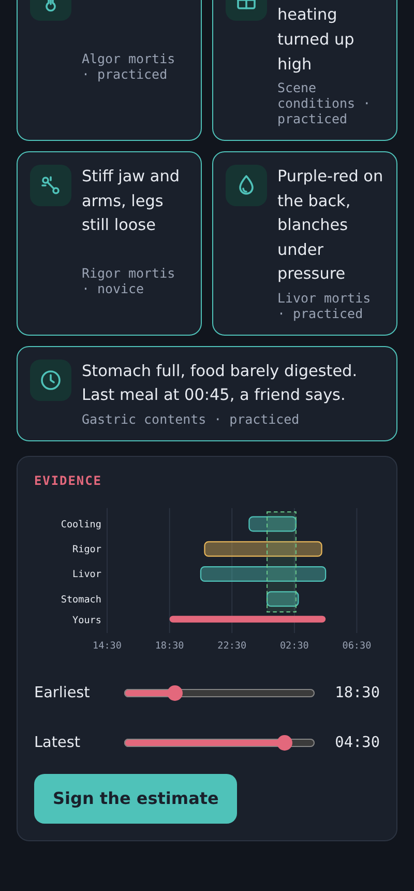

# Casework

A medical examiner game where the forensic science is real. Examine a body, learn what each finding
means at the moment you need it, and sign the death certificate: cause, manner, and a time-of-death
window that scores best when it is both right and tight.

> **Status:** early development. Playable so far: the **time-of-death drill**. Read the findings
> on a body, learn what each one means, set a time-of-death window and sign it. A 3D exam room is in
> progress.

<table>
  <tr>
    <td></td>
    <td></td>
    <td></td>
    <td></td>
  </tr>
  <tr>
    <td>1. Read the body</td>
    <td>2. Learn what a finding means</td>
    <td>3. Weigh the evidence</td>
    <td>4. Sign and see the truth</td>
  </tr>
</table>

Each skill's colour shows how well you know it: amber for novice (a wider bar), teal for practiced, green for mastered.

## How it plays (planned)

- **Examine:** spend shift hours on procedures (scene, external exam, autopsy, toxicology) and tap
  regions of the body on the table to reveal findings.
- **Interpret:** turning a finding into evidence needs a skill. If you don't have it yet, a
  one-question lesson opens right there. Your skill level sets how precise the evidence is.
- **Certify:** link interpretations to the certificate lines they support, then sign.
- **Debrief:** see what really happened. Every missed inference becomes a review card for your next
  shift.

The tone is clinical and non-graphic: a stylized mannequin, injuries shown as markers, and a
respectful line about each person.

## Design

- [docs/design.md](docs/design.md): core loop, decisions and milestones.
- Screenshots are made by `npm run shots` (see `tools/shots.cjs`), which plays one drill with a
  fixed seed (`?seed=99`) at phone and desktop sizes and fails on console errors or overflow.
- Architecture: ports and adapters. `src/kernel` (skills, lessons, review: reusable by other
  games), `src/casework` (the game rules), `src/adapters` (web UI, storage, Strata 3D). The layer
  rule is enforced by `tests/layers.test.ts`.

## Development

Requires Node 22.18 or newer (runs TypeScript tests directly).

```sh
npm install
npm test          # unit tests, including the layer rule
npm run typecheck
npm run build     # compiles src/ to dist/ for the browser
```

To play locally, build and then serve the repo root with any static server, for example
`python3 -m http.server 8770`, and open http://localhost:8770/.

## Accuracy

Lessons cite published sources, and teaching approximations (such as the 1.5 °F per hour cooling
rule) are labelled as approximations. Casework teaches the reasoning; it is not a reference for real
casework. Corrections are welcome as issues.

## License

Code: [MIT](LICENSE). Lessons, cases and other content in `packs/`: [CC BY-SA 4.0](LICENSE-CONTENT.md).
