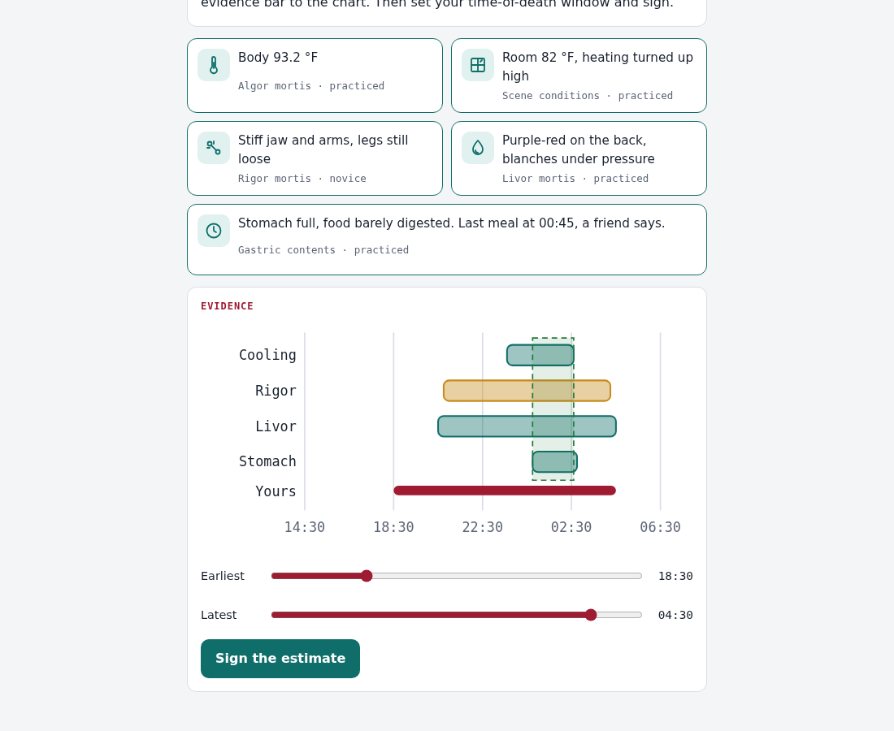
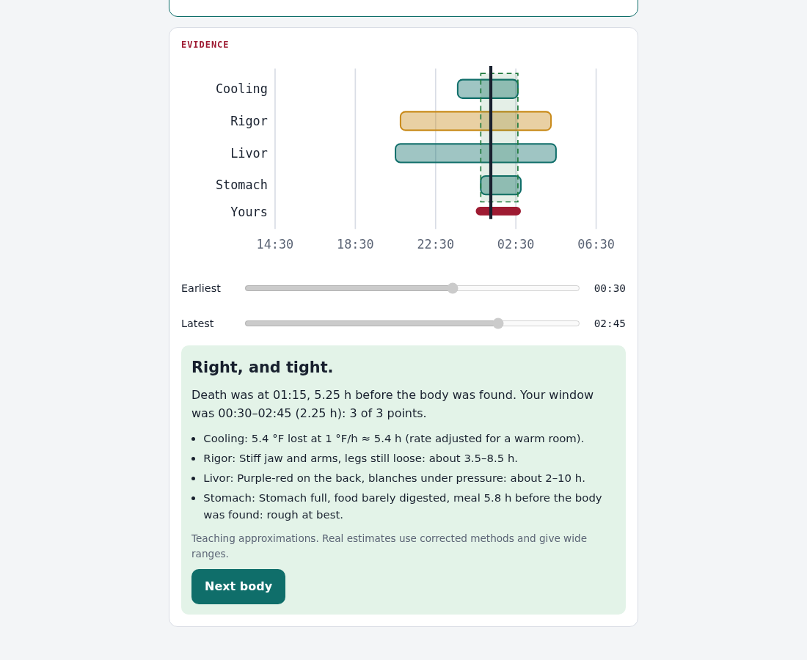

# Casework design

## Core loop

Nested loops:

| Loop | Length | What happens |
|---|---|---|
| Moment | ~30 s | Pick a finding and interpret it. A missing skill opens a one-question lesson in place. |
| Case | 5–10 min | Intake → Examine (spend hours) → Interpret → Certify → Debrief. |
| Shift | 15–20 min | Short spaced review, then 2–3 cases against an 8-hour clock and a lab budget. Toxicology returns next shift, so "pending" is a real choice. |
| Career | weeks | Accuracy builds reputation; reputation unlocks equipment; equipment adds procedures, findings and skills. |

## What the drill looks like

The milestone-1 drill on a desktop browser: the evidence bars from four skills, their overlap (dashed),
and the player's window (red). Rigor is a novice skill here, so its bar is wider.

After signing, the real time appears as a line and the debrief explains each bar:

## Rules

1. Every interpretation is a lesson-backed decision: findings are facts, interpretations need skills.
2. Teach just in time, then reinforce with spaced review.
3. Reward calibration: time of death is a window, scored on right and tight.
4. Time and money are the resources.
5. Respectful and non-graphic.
6. Skill level sets precision: novice skills give wider evidence bars; mastery narrows them.

## Decisions

| Question | Decision |
|---|---|
| Hosting | Standalone game on the arcade first. |
| Exam view | 3D exam room (Strata) by default from 0.1; 2D body map fallback; text list for screen readers. |
| Stack | TypeScript core and web UI; Strata renders the exam room. |
| Interpret on a phone | Tap to link an interpretation to a certificate line. No dragging. |
| Core structure | Ports and adapters; pure reducer `(state, command) → (state, events)`; versioned snapshot saves. |
| Content | Drafted with sources cited; no AI at runtime. Code MIT, content CC BY-SA 4.0. |
| Tone | Clinical, non-graphic, no child deaths in 0.1, content note at first launch. |

## Keeping options open

Casework may later become one game in a collection of educational games. Cheap habits so that stays
possible without building it now:

- `src/kernel` never imports Casework or adapters (tested).
- Lessons and cases are data packs with a manifest.
- Skill ids are namespaced, e.g. `forensics.algor-mortis`.
- Progress can be exported and imported as a file.

## Cases

A case is a JSON file in a content pack (`packs/forensics-core/cases/`). It lists procedures (hours,
cost, prerequisites), findings and the truth. Each finding says which procedure reveals it (and, for
the external exam, which body region and pose), the skill needed to interpret it, what it means,
and how it counts as evidence:

| `interp.kind` | Evidence |
|---|---|
| `range` | hours since death, e.g. rigor 3.5–8.5 h |
| `cooling` | body and room temperature; hours = (98.6 − body) ÷ rate, ±1.5 h. A scene finding with `coolingRate` changes the rate once interpreted |
| `after-meal` | stomach contents: `from`–`to` hours after a meal eaten at a known time |
| `alive-at` | someone saw the person alive this long before they were found |
| `claim` | not timing evidence; `supports` lists the cause or manner it backs up |

The rules are a pure reducer, `step(case, state, command, skills) → { state, events }`, in
`src/casework/case/play.ts`. The web page, the terminal and the tests all drive the same reducer.

### Scoring (12 points)

| Part | Points |
|---|---|
| Time | 3 if the window holds the real time and is ≤ 3 h wide, 2 if ≤ 6 h, 1 if wider, 0 if it misses |
| Cause | 3 if right |
| Manner | 3 if right; some cases give partial credit (e.g. 1 for "pending") |
| Reasoning | 2 if every link holds and each line has one; 1 if some links don't hold; 0 if a line has no valid support |
| Efficiency | 1 if no procedure beyond what the case needed |

Mistakes queue review cards for the skills behind them.

### The cases so far

| # | Case | Manner | Teaches |
|---|---|---|---|
| 1 | Night shift | natural | cooling corrected for an open window, rigor, livor, stomach; coronary disease; cause vs manner |
| 2 | The kitchen floor | accident | contrecoup injury from a fall; blood thinners make a fall deadlier but don't change the manner |
| 3 | The basement stairs | homicide | the body's timeline contradicts the account; hat brim rule; defense injuries; what "homicide" on a certificate means |

## Milestones

1. ✓ **Spike and drill toy.** Strata exam-room spike (go/no-go). Learning kernel plus a generated
   time-of-death drill. Gate: is the mechanic fun?
2. **Case 1 end to end.** ✓ Reducer core, tap-to-link certificate, 3D exam room with list
   fallback, terminal adapter, an expert solver test, and two more cases.
3. **Casework 0.1.** Shift loop, 8 cases covering all five manners plus "pending", morning review,
   versioned save.
4. **Tuning.** Scoring from playtests, accuracy pass, first equipment upgrade.
